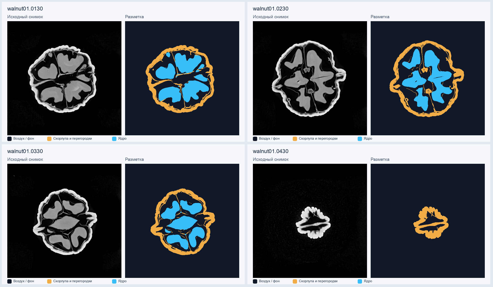
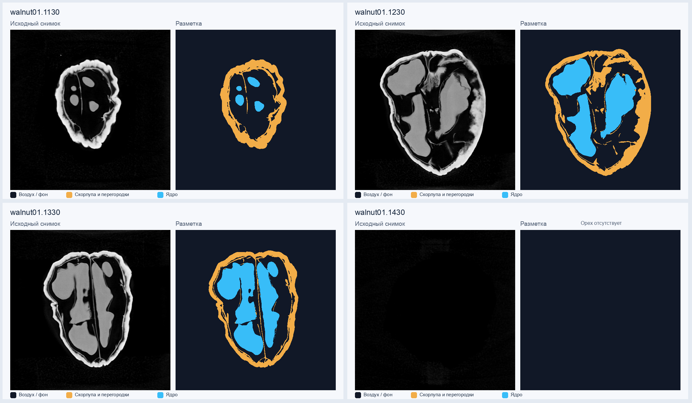
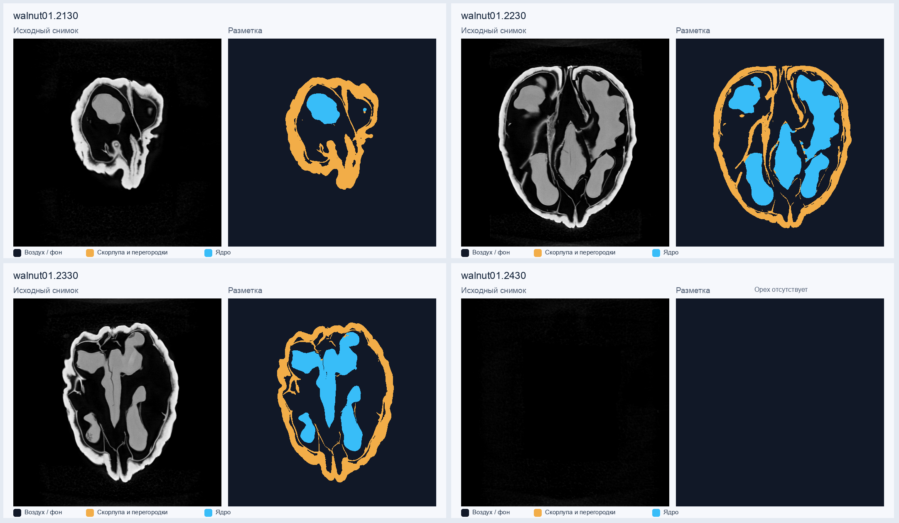

# walnut
опорная статья: A Cone-Beam X-Ray CT Data Collection Designed for Machine Learning, 2019, doi:  [10.1038/s41597-019-0235-y](https://doi.org/10.1038/s41597-019-0235-y)

данные: реконструкции грецких орехов

размер: $501 \times 501$

## Разметка проекта

Подготовлена первая версия масок для 12 сечений: воздух/фон, скорлупа с
перегородками, ядро. [Описание классов, данных и ограничений](annotations/README.md).

Исходные TIFF без потери точности: `data/images/`.
Числовые маски классов 0/1/2: `annotations/masks/`.
Для просмотра слева показан исходный снимок, справа — цветная разметка.

