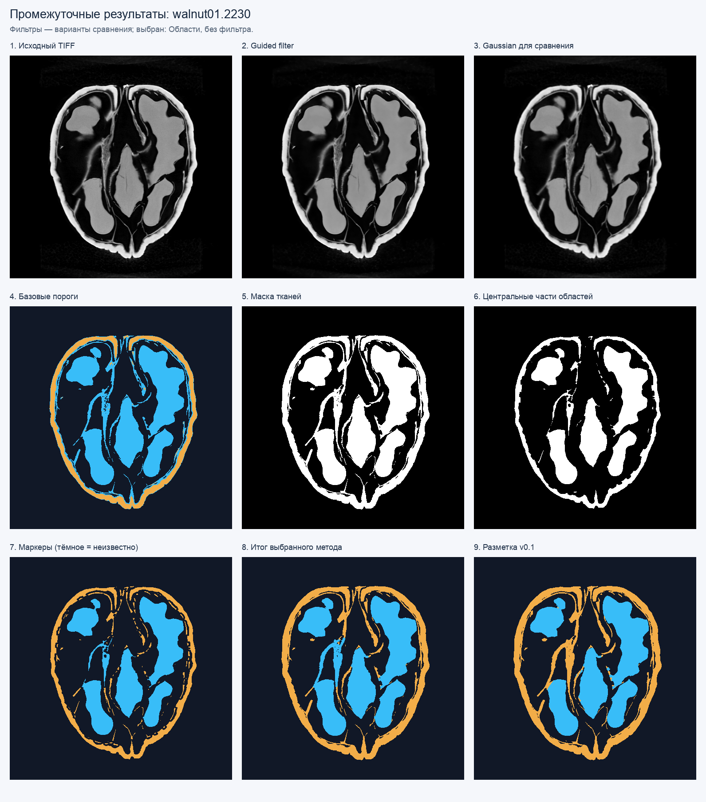
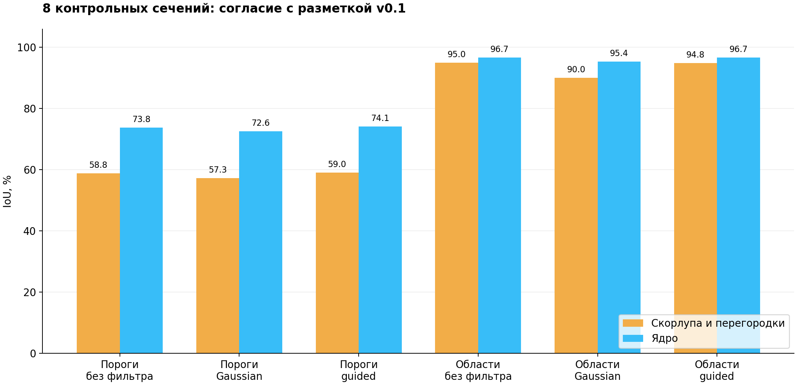
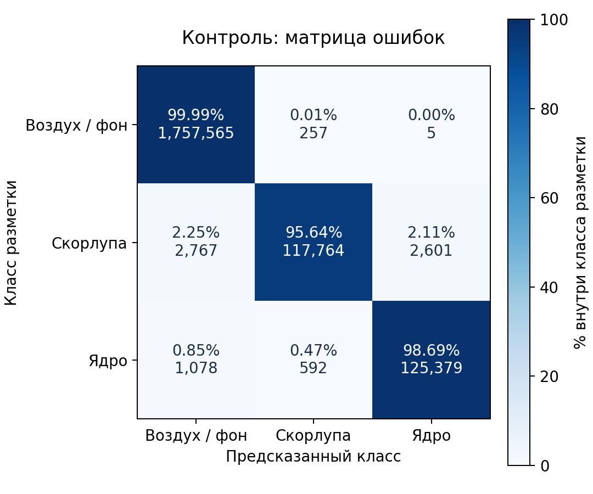
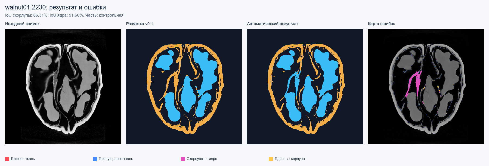
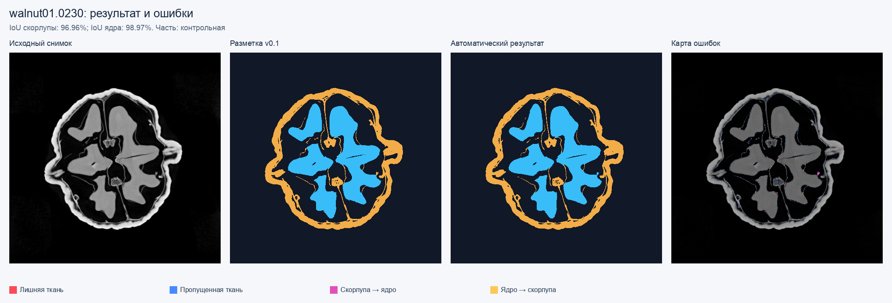

# Этап 2. Предобработка и автоматическая сегментация

Дата: 20 октября 2026 года.

Код и данные: [папка walnut01 в репозитории проекта](https://github.com/Zusemar/misis2025f-23-01-vasilenko-a-a/tree/codex/walnut-segmentation/walnut01).

## Постановка задачи

На вход подаётся одно одноканальное сечение КТ в формате float32 TIFF.
На выходе получается маска 0/1/2: воздух и фон, скорлупа с различимыми
перегородками, ядро. Обрабатываются исходные 501 × 501 пиксель без изменения
геометрии и без потери точности исходного изображения. Проект работает с
готовыми реконструкциями; реконструкция КТ из рентгеновских проекций не нужна.

В работе используются 12 учебных изображений одного ореха, а не полный объём
501³ из исходной статьи. Последовательность этих файлов не выдаётся за
полноценную пространственную сетку для 3D-обработки.

## Схема обработки

1. Проверка типа и значений входа, приведение к рабочей шкале делением на 0,067.
2. Выбор предобработки: без фильтра, Gaussian или guided filter.
3. Автоматический подбор двух порогов по максимуму межклассовой дисперсии
   трёх групп гистограммы (обобщение метода Отцу).
4. Получение маски тканей с ограничением снизу порога по шумовому уровню.
   Изолированные компоненты менее трёх пикселей удаляются. Если максимум
   исходной интенсивности ниже 0,012, сечение считается фоновым.
5. Базовый вариант сразу относит средний диапазон яркости к ядру, верхний —
   к скорлупе. Метод по областям выделяет центральные части связных областей
   эрозией, рассматривает их медианную яркость и локальную текстуру.
6. Из центральных частей автоматически получаются маркеры классов. Далёкие
   от них тонкие участки маркируются как перегородки. Классы распространяются
   внутри маски тканей по кратчайшим путям с большей стоимостью перехода
   через скачок яркости. Несвязанные тонкие фрагменты относятся к перегородкам.

Последний шаг реализован как распространение маркеров по алгоритму Дейкстры
на 8-связном графе пикселей. Это собственная маркерная схема, а не вызов
watershed с ручными точками. Входные точки разметки программе не передаются.

Для центральной области класс ядра предполагается, если медианная нормированная
яркость находится между 0,40 и автоматически рассчитанным порогом скорлупы,
а среднее локальное СКО в окне 7 × 7 не превышает 0,10. Остальные центральные
области служат маркерами скорлупы. Эти численные предположения привязаны к
данной шкале интенсивности и требуют проверки при смене данных.

## Фильтр с сохранением границ

Реализован self-guided filter по [He, Sun, Tang, Guided Image Filtering](https://people.csail.mit.edu/kaiming/publications/pami12guidedfilter.pdf).
Само исходное изображение служит направляющим. Для локальных среднего μ
и дисперсии σ² вычисляются `a = σ² / (σ² + ε)`, `b = μ - aμ`, а выход —
`q = mean(a) · I + mean(b)`. Локальные средние считаются через `boxFilter`.
Границы обрабатываются отражением; дополнительный модуль OpenCV не нужен.

В областях с сильным перепадом яркости коэффициент a ближе к 1, поэтому
переход сглаживается слабее, чем внутри однородной области. Сохранение
константы и резкого перепада проверено отдельными искусственными примерами.

Фильтры исследуются как отдельные ветки. Основным по результатам настройки
выбран вариант по областям без сглаживания. На этих реконструкциях сильная
фильтрация особенно опасна для тонких перегородок и небольших профилей ядра.

## Протокол эксперимента

До подбора параметров заданы четыре настроечных и восемь контрольных сечений.
На настроечных проверено 108 сочетаний фильтра, его параметров, множителя
порога и радиуса центральных областей. Критерий — средний IoU скорлупы и ядра
из суммарной матрицы ошибок. Сетка и все испытания сохранены в JSON.

Первый технический прогон сохранён отдельно. После него искусственный тест
выявил распространение класса ядра вдоль тонкой перегородки. Реализация
исправлена по этому примеру; уже выбранные параметры не перенастраивались.
Итоговые цифры относятся к повторной проверке после этого исправления.

Разметка v0.1 полуавтоматическая. Во время оценки она не менялась — это
проверено контрольными суммами. Все снимки относятся к одному ореху;
сечения могут пересекать одни и те же структуры. Это ограничивает независимость
настроечной и контрольной частей. Перенос на новый орех не измерен.

## Результаты на контрольных сечениях

| Предобработка и сегментация | IoU скорлупы | IoU ядра | Средний IoU тканей |
|---|---:|---:|---:|
| Без фильтра, пороги | 58,82% | 73,79% | 66,30% |
| Gaussian, пороги | 57,27% | 72,60% | 64,93% |
| Guided, пороги | 59,00% | 74,15% | 66,57% |
| Без фильтра, области | **94,99%** | **96,70%** | **95,84%** |
| Gaussian, области | 90,01% | 95,39% | 92,70% |
| Guided, области | 94,84% | 96,68% | 95,76% |

У каждого варианта параметры выбраны отдельно по настроечной части. Отдельное
сравнение с фиксированными параметрами сегментации также сохранено в данных:
без фильтра — 95,84%, guided — 95,76%, Gaussian с σ=1 — 80,36%.
Последняя тройка исследует замену только предобработки и не означает, что
Gaussian был настроен оптимально в этой абляции.

Для основного варианта Dice скорлупы равен 97,43%, Dice ядра — 98,32%.
Средний F1 границ при допуске 1 пиксель: 98,06% для скорлупы и 95,27% для ядра.
Общая точность по всем пикселям не используется как главный вывод, поскольку
большую часть изображения занимает фон.

## Ошибки и ограничения

Самое трудное контрольное сечение — 2230: IoU скорлупы 86,31%, ядра 91,66%.
Основная ошибка — широкая внутренняя перегородка, по яркости и текстуре
похожая на ткань ядра. Это систематическая неоднозначность используемых
признаков, а не шум, который можно гарантированно удалить фильтром.

Для сравнения, на контрольном 0230 IoU скорлупы — 96,96%, ядра — 98,97%.

Сечения 1430 и 2430 корректно распознаны как фоновые; 0430 не получил
ложного класса ядра. Отсутствующий класс не добавляет искусственные 100%
к усреднению. Ошибки учитываются и на пустых сечениях, если метод всё же
предсказывает там ткань.

Указанные значения показывают согласие с агентной разметкой v0.1. Она сама
создавалась с помощью яркостных операций, что делает её ограниченным эталоном
для методов, использующих яркость. Нужны проверка спорных перегородок человеком
и дополнительный орех, чтобы подтвердить более широкую применимость.

## Проверка реализации и вывод

Выполнена сборка C++20 с OpenCV 4.13.0, проверены сохранение константы и
резкого перепада guided filter, фоновые изображения, три класса на искусственном
сечении и тонкая перегородка. Некорректный тип входа и NaN отвергаются.
Четыре Python-теста проверяют матрицу ошибок, IoU/Dice на известном примере,
отсутствующие классы, допуск границ и недопустимые метки.

Дополнительно TIFF переименован и обработан без аргументов разметки:
результат совпадает с прежним, что проверяет независимость от имени файла.

Метод по областям улучшил согласие с разметкой с 66,30% до 95,84% по среднему
IoU тканей. Guided filter сохранён как воспроизводимый экспериментальный
вариант. На чистых реконструкциях этой выборки оснований объявлять его
преимущество нет. Следующая содержательная проверка — независимая ревизия
разметки широких перегородок и применение на другом орехе.

## Источники

1. Der Sarkissian H. et al. A cone-beam X-ray computed tomography data collection
   designed for machine learning. Scientific Data 6, 215 (2019).
   [DOI](https://doi.org/10.1038/s41597-019-0235-y).
2. He K., Sun J., Tang X. Guided Image Filtering. IEEE TPAMI 35(6), 2013.
   [Текст авторов](https://people.csail.mit.edu/kaiming/publications/pami12guidedfilter.pdf).
3. OpenCV. [Image Filtering](https://docs.opencv.org/4.x/d4/d86/group__imgproc__filter.html),
   [Miscellaneous Image Transformations](https://docs.opencv.org/4.x/d7/d1b/group__imgproc__misc.html).
